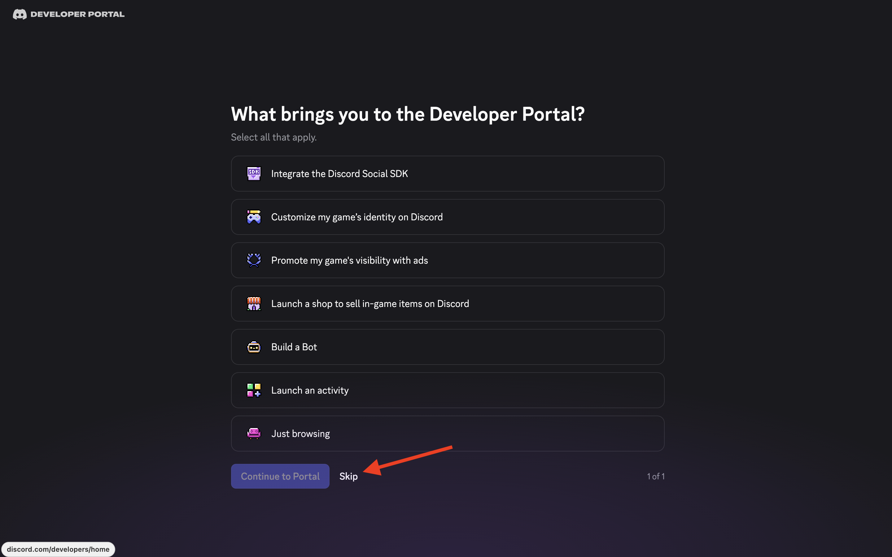
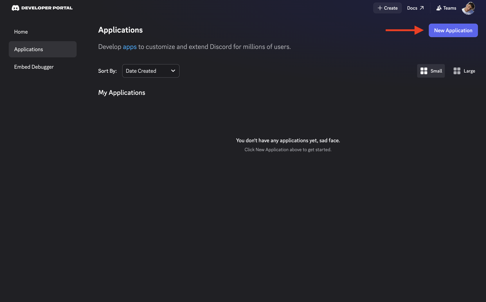
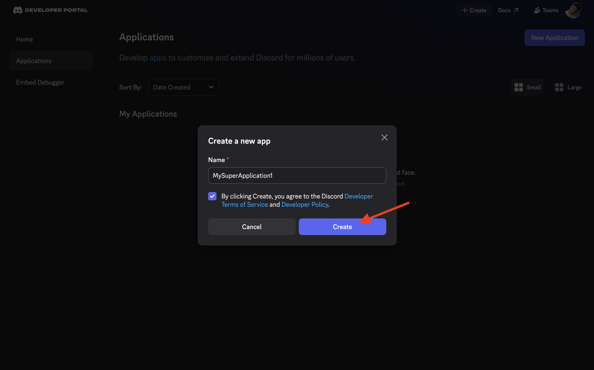
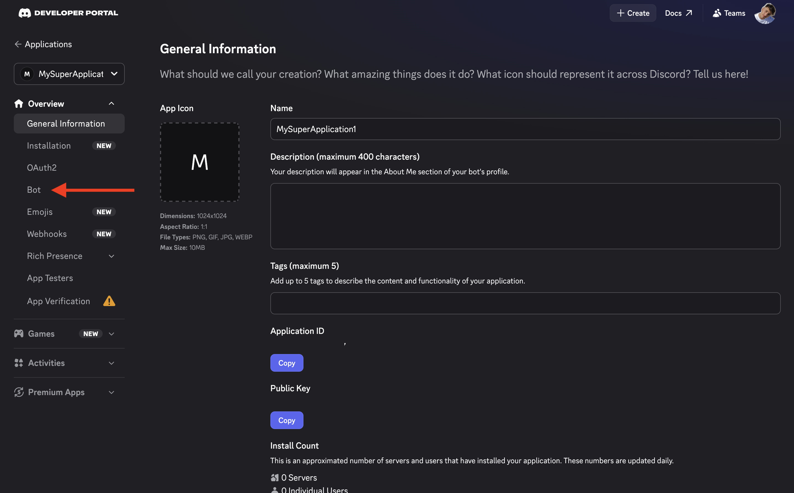
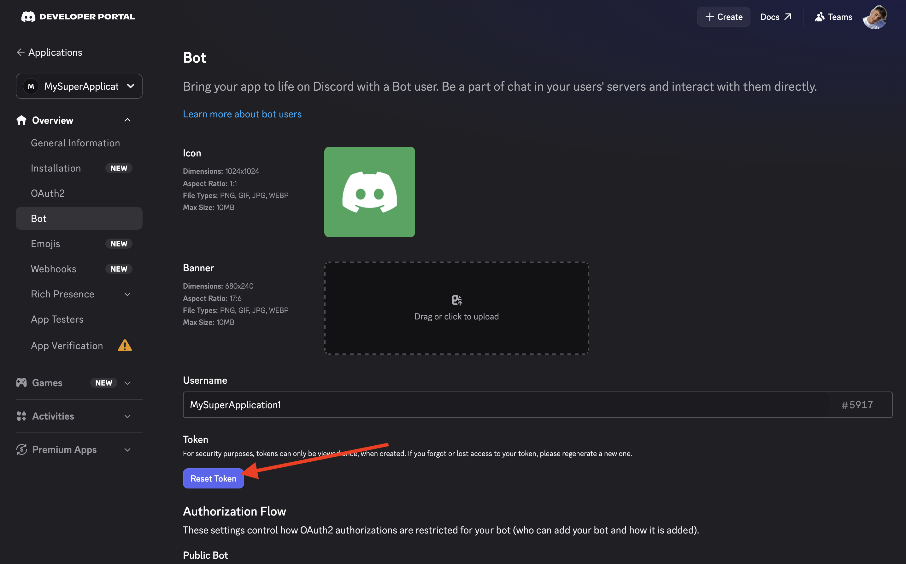
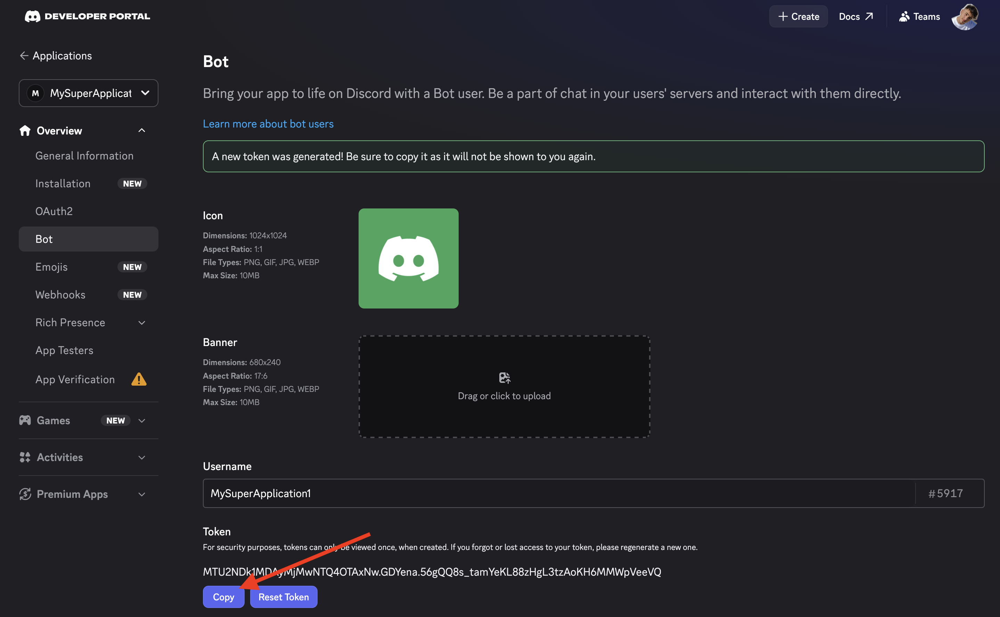

# Create a bot token

To create a bot token, you will need to got to [https://discord.com/developers/applications](https://discord.com/developers/applications) while being connected to your (preferably not personnal) discord account.

If you are being asked what bring you to the developer portal, just skip we don't care.

Then on the application page, create a new application.

Fill-in a name (can be anything), accept the ToS (I am not responsible for that part) and create the application.

Then select the bot page on the left navigation bar

Click on reset token to get the bot token (it might ask for authentification, just put your password)

And finally you can copy the bot token (the token on this image has already been revoked don't worry), store it within a file on your computer so that you don't lose it.

