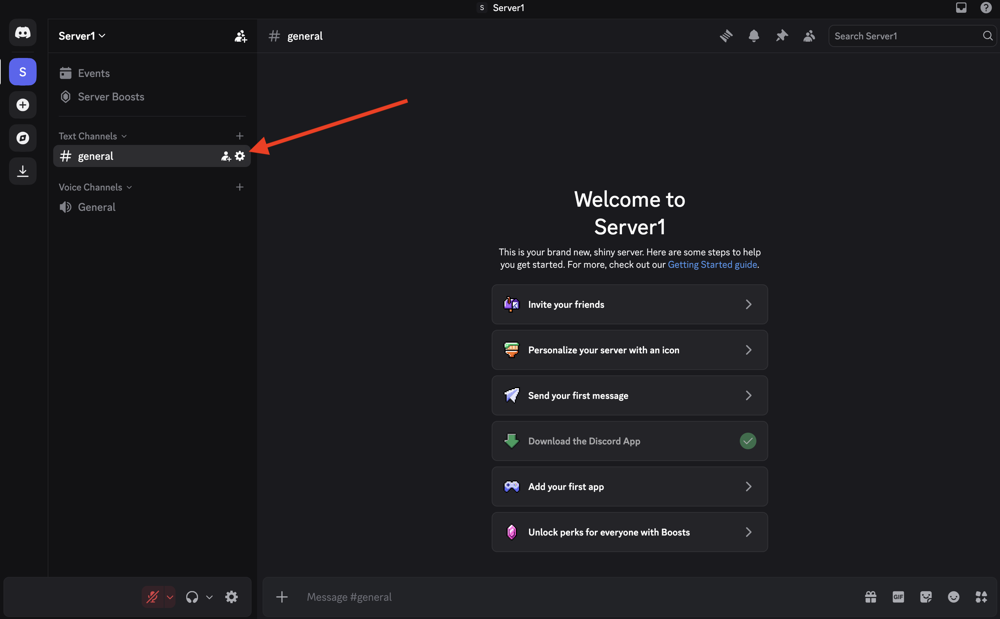
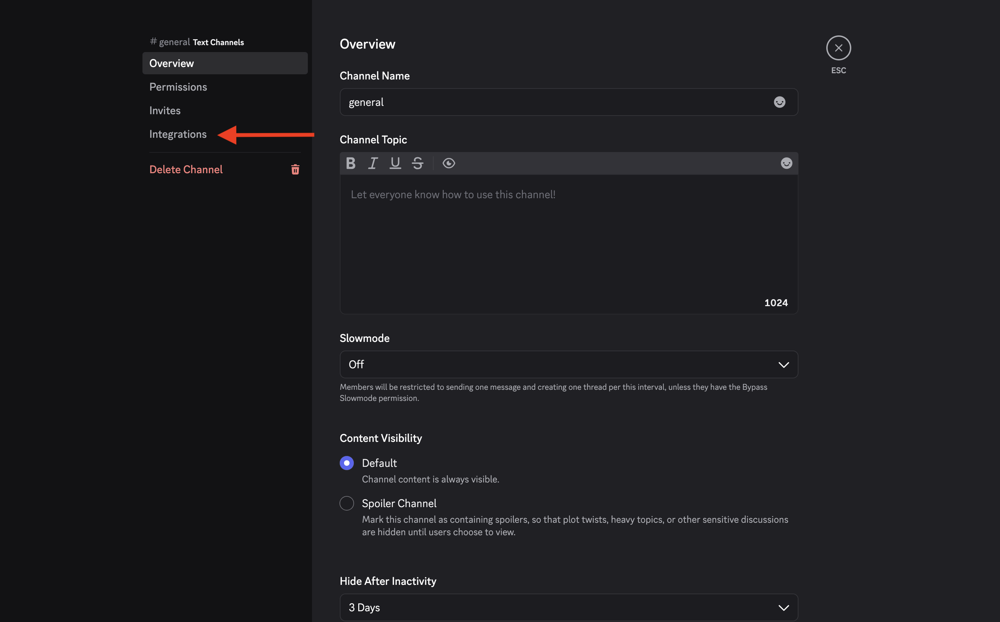
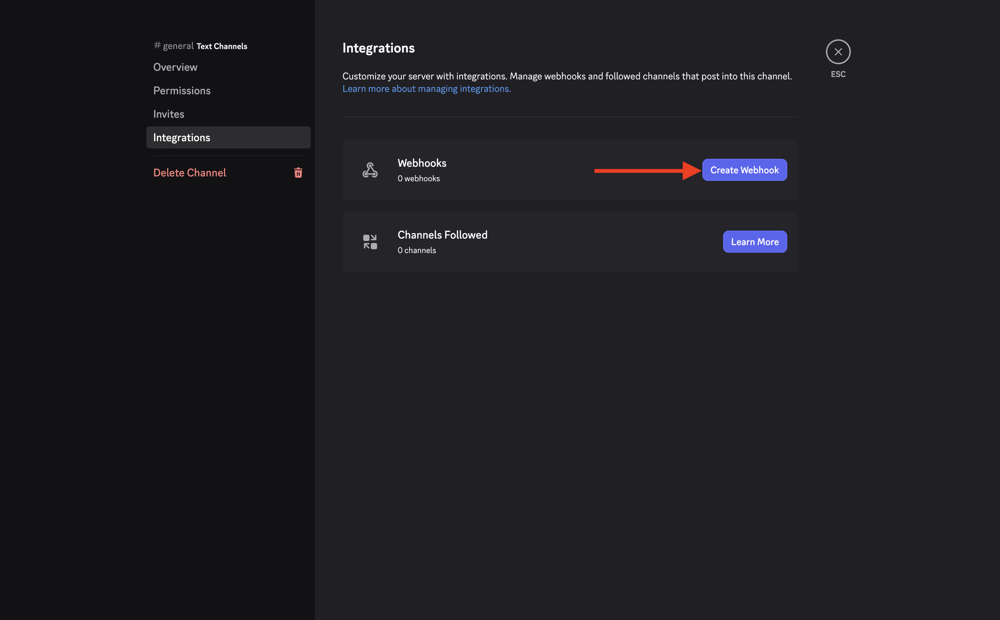
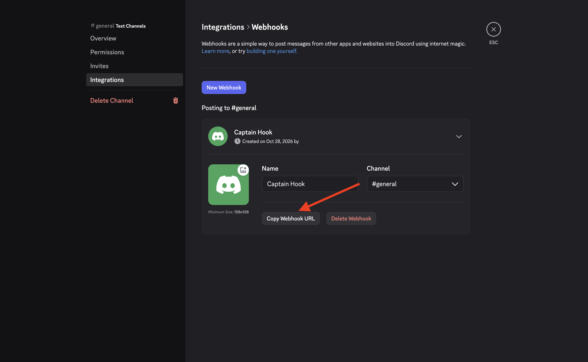

# Create a webhook

To create a webhook, you first need an (preferably empty) discord server.

Then go to the default channel (or any channel) settings.

And click on integrations.

Then create a webhook.

And finally copy the URL for your webhook. Do not forget to store it somewhere (open a notepad and paste it into).

